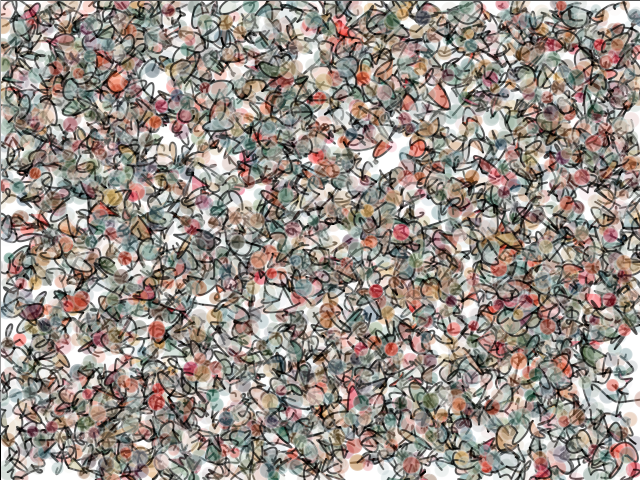

# Transitive Bullshit (2013)

> Travis Fischer's 2013 portfolio: interactive Processing sketches, WebGL experiments, and engineering write-ups.

This is the full source of the original *transitivebullsh.it* portfolio and blog, preserved and modernized so it still runs. It's a small Django site that serves hand-written articles and a lab of live, editable generative-art sketches.

## What's inside

- **Processing lab:** a dozen generative-art sketches (RRTs, Hilbert curves, n-body gravity, Substrate, The Ring, Trema…) running live via Processing.js, with an in-browser editor that exposes tweakable parameters.
- **WebGL lab:** three.js experiments (origami, audio-reactive flocking, Turing patterns).
- **Articles:** a crinkled CSS map, CSS blur filters, Stamped (acquired by Yahoo! in 2012), Pixar's *Up*, the Milton thesis, TI calculator games, and an about page.

## How it was made

- Django templates for pages and articles; no database.
- Processing.js, three.js, jQuery, Isotope, and fancybox, vendored under `server/assets/js/libs`.
- LESS stylesheets compiled to the committed CSS.

## License

The code is [MIT](license) © [Travis Fischer](https://x.com/transitive_bs). Vendored libraries keep their own licenses; some sketches credit original concepts by Casey Reas and J. Tarbell.

---

Want to run it, change it, or see where everything lives? See [contributing.md](contributing.md).
